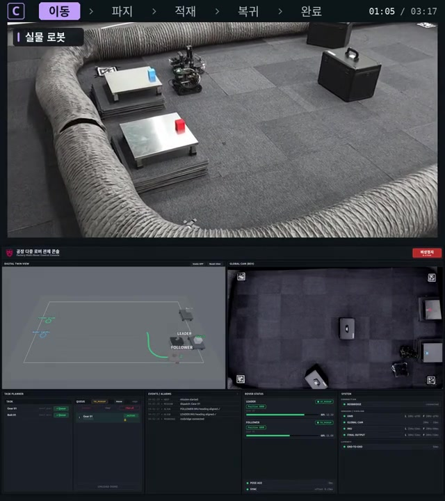
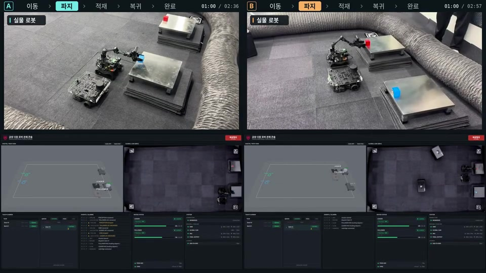
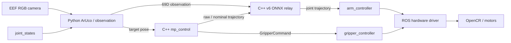

# OMX TurtleBot Delivery Robot

TurtleBot3 기반 리더·팔로워와 OpenMANIPULATOR-X를 사용하는 ROS 2 Humble 로봇 프로젝트다.
EEF RGB 카메라로 물체의 ArUco ID를 인식하고, C++ `mp_control` 기준 경로에
v6 ONNX 정책의 제한된 관절 보정량을 더해 픽앤플레이스를 수행한다.
**최종 배포본은 실제 로봇에서 의도한 동작을 정상 수행했으며, 사용자 확인을 완료했다.**

## 최종 시현 영상

리더·팔로워의 이동과 물체 파지·배치, 작업 완료까지의 최종 시현 결과다.
미리보기 이미지를 누르면 해당 MP4 파일을 열 수 있다.

| 최종 시현 1 · 3분 17초 | 최종 시현 2 · 2분 57초 |
|---|---|
| [](./docs/assets/final_robot_20261124/final_demo_01.mp4) | [](./docs/assets/final_robot_20261124/final_demo_02.mp4) |
| [영상 보기 · MP4](./docs/assets/final_robot_20261124/final_demo_01.mp4) | [영상 보기 · MP4](./docs/assets/final_robot_20261124/final_demo_02.mp4) |

제공된 최종 시현 원본을 H.264 MP4로 인코딩한 재생용 사본이다.
영상 길이와 전체 동작 순서를 유지했다.

## 실제 로봇 배포 기준

아래 실행 안내는 실제 Jetson에 배포해 성공한 **v6 ROS relay 구성**을 기준으로 한다.
최종 통합 시현 영상과 별도로, 팔 제어의 재현 가능한 성공 설정을 다음 기록에 보존했다.

| 항목 | 확인된 값 |
|---|---|
| 로봇 | 궤도형 리더 + OpenMANIPULATOR-X, Jetson Orin Nano + OpenCR |
| ROS | ROS 2 Humble, `ROS_DOMAIN_ID=25` |
| 로봇 하드웨어 워크스페이스 | `/home/a/turtlebot3_ws` |
| v6 배포 워크스페이스 | `/home/a/omx_v6_cpp_ws_20261122` |
| 성공 기준 소스 | `7f1ad28`, 태그 `robot-lift-pick-place-20261123-0320` |
| 기록된 성공 run_id | `lift_near_id0_20261123_0320` |
| 성공 동작 | ID 0 집기 → 들어올리기 → 오른쪽 90° 회전 → 내려놓기 → 열기 → Stay |
| 자동 실행 소요 시간 | 약 38.7초, 해당 run의 시작 요청부터 완료까지 |
| 모델 / 입력 / 출력 | `omx_turtlebot3_v6` / 69차원 / 4차원 관절 보정량 |
| 추론 | C++ OpenCV DNN, 원본 ONNX, CPU |

실기 성공 설정과 근거는 [2026-11-23 실물 검증 기록](./omx_turtlebot3_control_cpp/docs/robot_validation_20261123_lift.md)에 있다.
시간은 해당 실행의 측정값이며, 반복 시험 성공률로 환산하지 않는다.

## 배포한 제어 구조



- `mp_control`이 팔 전개·파지·이송·해제·Stay 복귀 순서와 기준 경로를 만든다.
- `ros_policy_relay_cpp`가 raw joint3 방향을 한 번 변환하고, v6 추론의 제한된 보정량을
  기준 경로에 더해 `/arm_controller/joint_trajectory`로 보낸다. ONNX 출력은 절대 관절각이 아니다.
- Python 관측 노드는 실제 EEF 영상과 관절 피드백으로 ArUco 자세와 69차원 입력을 구성한다.
  mission gate는 실측 Stay, 선택한 마커, 활성 제어기와 정책 입력을 확인한 뒤 한 번 시작한다.
- **OpenCR 직렬 포트는 기존 ROS 하드웨어 드라이버 하나가 소유한다.**
  이 배포 경로의 미션 런치는 직렬 포트를 직접 열지 않는다.

베이스 이동과 리더·팔로워의 전체 임무 연결은 호스트·navigation 연동 영역이다.
아래 v6 미션 명령은 정지한 리더의 팔 동작을 실행하는 진입점이다.

| 패키지 | 배포 구성에서의 역할 |
|---|---|
| [`mp_control`](./mp_control/README.md) | 실제 로봇 기준 경로, 그리퍼와 handoff 시퀀스 |
| [`omx_turtlebot3_control_cpp`](./omx_turtlebot3_control_cpp/README.md) | v6 C++ ONNX 추론, residual과 ROS trajectory relay |
| [`omx_turtlebot3_runtime`](./omx_turtlebot3_runtime/README.md) | EEF ArUco 관측, 69차원 입력, 시작 조건·로그·미션 launch |
| [`omx_turtlebot3_policy`](./omx_turtlebot3_policy/README.md) | 원본 v6 모델, 관측 계약과 검증 벡터 |
| [`turtlebot3_manipulation_bringup`](./turtlebot3_manipulation/turtlebot3_manipulation_bringup/README.md) | 하드웨어, ros2_control, Stay 초기화와 TF |
| [`turtlebot3_control`](./turtlebot3_control/README.md) | 기존 v4 배송 coordinator와 베이스 mux |

## 빌드와 실행 환경

호스트 소스 저장소는 `/home/ktj/omx_turtle_ws/src`다. v6 관련 패키지만 빌드하려면:

```bash
cd /home/ktj/omx_turtle_ws
source /opt/ros/humble/setup.bash
colcon build --base-paths src --packages-up-to omx_turtlebot3_runtime \
  --cmake-args -DCMAKE_BUILD_TYPE=Release
source install/setup.bash
```

Jetson에서는 기존 하드웨어 워크스페이스 위에 배포 소스를 빌드한다.

```bash
cd /home/a/omx_v6_cpp_ws_20261122
source /opt/ros/humble/setup.bash
source /home/a/turtlebot3_ws/install/setup.bash
colcon build --base-paths src --packages-up-to omx_turtlebot3_runtime \
  --allow-overriding mp_control --cmake-args -DCMAKE_BUILD_TYPE=Release
source install/setup.bash
```

C++ 추론에는 OpenCV DNN이 필요하다. Python 관측 환경은 ROS Humble의 Python 3.10,
NumPy 1.x, SciPy, MuJoCo 3.10.0, OpenCV ArUco와 ROS 영상 의존성을 사용한다.
MuJoCo는 FK·기구학 계산에 사용하며 실물 입력은 카메라와 관절 피드백에서 얻는다.
Jetson의 관측 Python은 `OMX_CPP_PYTHON` 또는 launch의 `python_executable`로 지정한다.

각 로봇 터미널에서 다음 환경을 적용한다.

```bash
export ROS_DOMAIN_ID=25 PYTHONNOUSERSITE=1
source /opt/ros/humble/setup.bash
source /home/a/turtlebot3_ws/install/setup.bash
source /home/a/omx_v6_cpp_ws_20261122/install/setup.bash
export OMX_CPP_PYTHON=/home/a/turtlebot3_ws/.venv_omx_runtime/bin/python
```

## 실제 로봇 실행

### 1. 하드웨어와 Stay 준비

새 하드웨어 세션에서는 아래 명령으로 시작한다. 이 명령은 실제 팔을 Stay로 이동시킨다.
이미 같은 ROS domain에서 하드웨어가 실행 중이면 기존 세션을 사용한다.

```bash
ros2 launch turtlebot3_manipulation_bringup hardware.launch.py \
  use_fake_hardware:=false move_to_stay_pose:=true \
  start_rviz:=false start_camera:=false start_eef_camera_driver:=false \
  start_lidar:=false start_state_relays:=false \
  eef_usb_camera_rpy:="0.0 1.57079633 0.0"
```

Stay 목표는 joint1~4 순서로 `[0.104311, 0.027612, -0.001534, -1.638291]` rad다.
`arm_controller`와 `gripper_controller`가 active이고 실제 관절이 정지한 뒤 미션을 시작한다.

### 2. 미션 시작 조건 확인

같은 환경을 적용한 다른 터미널에서 실행한다. 기본 `execute:=false`는
미션을 시작하거나 모터 명령을 보내지 않고 준비 상태를 확인한 뒤 종료한다.

```bash
ros2 launch omx_turtlebot3_runtime ros_policy_pick_place.launch.py \
  marker_id:=0
```

카메라는 launch에서 시작한다. 기존 `/eef_camera/image_raw`와
`/eef_camera/camera_info` 발행기를 사용할 때는 `start_camera:=false`를 추가한다.
기본 장치는 Jieli USB 카메라의 `/dev/v4l/by-id/usb-Jieli_Technology_USB_Composite_Device-video-index0`이며
다른 장치를 쓰면 `video_device`를 지정한다.

### 3. 최종 성공 설정으로 한 번 실행

```bash
ros2 launch omx_turtlebot3_runtime ros_policy_pick_place.launch.py \
  execute:=true marker_id:=0 retract_mode:=lift
```

시작 시 원본 ONNX의 973개 검증 벡터를 확인한다. 실측 Stay와 선택한 마커,
활성 제어기·관측·정책 입력이 준비되면 자동으로 한 번 실행한다.
완료 후 미션 노드와 미션에서 시작한 카메라는 종료하고 외부 하드웨어 드라이버는 Stay를 유지한다.
성공 기록의 종료 상태는 **관절 정지·Stay·그리퍼 열림**이다.

`marker_id:=1`도 지원한다. 시작에는 선택한 마커 하나만 필요하며,
선택하지 않은 마커로 대상을 바꾸지 않는다. 위 성공 run의 대상은 ID 0이다.
실물 마커는 `DICT_4X4_50`, 검은 정사각형 한 변 40 mm이고 대상 물체 폭은 50 mm 기준이다.

## 최종 동작과 핵심 설정

1. 선택한 ArUco 물체에 정렬하고 팔을 전개해 그리퍼를 닫는다.
2. 집은 시점의 실제 joint2·3·4를 저장하고 joint2를 −0.55 rad 이동해 들어올린다.
   joint4는 팔 자세에 맞춰 연동한다.
3. 들어올린 뒤 joint1을 오른쪽 90° 회전한다.
4. 회전한 joint1을 유지하며 joint2·3·4를 저장한 집기 자세로 복원해 내려놓는다.
5. 내려놓은 자세에서 정지하고 그리퍼를 연다.
6. 실제 열림 피드백을 확인한 뒤 Stay로 복귀한다.

| 설정 | 성공값 |
|---|---|
| `retract_mode` | `lift` (현재 기본값) |
| `handoff_lift_joint2_delta_rad` | `-0.55` |
| `handoff_retract_joint3_delta_rad` | `0.0` (별도의 몸쪽 접힘 없음) |
| `handoff_restore_grasp_pose` / `handoff_lower_before_release` | `true` / `true` |
| 들어올리기 / 내려놓기 / 회전 시간 | `1.8 / 2.0 / 7.0`초 |
| `hold_joint4_during_extension` | `false` (joint4 연동 자세 보상) |
| `gripper_down_joint4_offset_rad` | `0.20` |
| 전개 이동 / 안정화 | `0.35 / 0.05`초 |

이 설정은 [미션 launch](./omx_turtlebot3_runtime/launch/ros_policy_pick_place.launch.py)에서
`mp_control_aruco_params.yaml`에 덮어쓴다. 일반 RGB-D용 `mp_control_real_params.yaml`과 구분해서 사용한다.

## 상태와 실행 기록

```bash
ros2 control list_controllers
ros2 topic echo /mp_control/status
ros2 topic echo /omx_v6/observer_ready
ros2 topic echo /omx_v6/policy_ready
ros2 topic echo /joint_states --once
ros2 topic info -v /arm_controller/joint_trajectory
```

실행마다 새 `log_dir`를 사용한다. 기본값은 `/tmp/omx_ros_policy_trial_<고유값>`이다.
`controller_profile.yaml`, `gate.jsonl`, `observer/observer.jsonl`, 카메라 프레임과 ROS 로그가 저장된다.
`CONTROLLER_SEQUENCE_COMPLETE`는 제어 순서 완료 기록이며, 최종 실기 성공은 현장 확인과 함께 기록했다.

같은 팔에 명령하는 구형 RL 노드, trajectory transformer 또는 직접 OpenCR 런타임은
동시에 실행하지 않는다. 실행 도중 중단은 `/omx_v6/policy_cancel`의 Bool true로 요청한다.

```bash
ros2 topic pub --once /omx_v6/policy_cancel std_msgs/msg/Bool '{data: true}'
```

## 기존 구현과 추가 도구

- **v4 배송 제어:** `omx_rl_control` / `omx_rl_control_cpp`는 33차원 입력의 기존
  Python·TorchScript/Eigen 경로다. `turtlebot3_control/omx_turtle.launch.py`는 이 구성을 실행한다.
  위 v6 ROS relay 실행 안내와는 별도다.
- **v6 직접 OpenCR 런타임:** `real_robot_cpp.launch.py`는 ROS 하드웨어 드라이버 대신
  직접 직렬 통신하는 별도 경로다. 별도 실물 보정과 deadman·요청 조건을 요구하며,
  이 README의 성공 기준은 `ros_policy_pick_place.launch.py` 경로다.
- **수평 후퇴:** `retract_mode:=cartesian`과 이전 `joint` 모드는 남아 있다.
  최종 성공 기본값은 들어올린 뒤 회전하는 `lift`다.
- **디지털 트윈:** [리더 모델](<./docs/12. 리더 터틀봇 영상 기반 디지털 트윈 URDF.md>),
  [호스트 모니터](<./docs/14. 리더 픽앤플레이스 호스트 모니터.md>),
  [다중 물체 인지·2단 정리대](<./docs/15. 그리퍼 다중 물체 인지와 2단 정리대 디지털 트윈.md>)를 참고한다.

## 문서

- [최종 실기 성공 설정과 재현 명령](./omx_turtlebot3_control_cpp/docs/robot_validation_20261123_lift.md)
- [v6 C++ ONNX 제어](./omx_turtlebot3_control_cpp/README.md)
- [v6 관측·미션 런타임](./omx_turtlebot3_runtime/README.md)
- [개발 문서와 이전 설계 색인](./docs/README.md)
