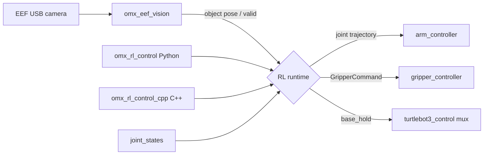

# OMX TurtleBot Delivery Robot

TurtleBot3 Waffle Pi와 OpenMANIPULATOR-X를 사용하는 ROS 2 Humble 실제 로봇
워크스페이스다. EEF 카메라의 ArUco 자세를 `base_link`로 변환하고, 학습된
PPO residual 정책과 결정론적 기준 경로로 물체를 파지한다.

현재 매니퓰레이터 구현 범위는 **ArUco 인식 → PICK → Stay 운반 자세 →
외부 베이스 이동 → PLACE → Stay 복귀**다. 최신
`arm_delivery_pitch_hold_v4`는 PICK과 PLACE를 함께 학습했다. 베이스
목표 생성과 이동은 외부 navigation 패키지의 책임이며, 이 저장소의
coordinator는 출발·도착 신호를 받아 두 팔 동작을 연결한다.

## 현재 구성



Python과 C++ 런타임은 선택 관계이며 동시에 실행하지 않는다.

| 패키지 | 역할 | 상태 |
|---|---|---|
| [`omx_eef_vision`](./omx_eef_vision/) | ArUco 검출, 품질 판정, TF, 목표 자세 | 구현 |
| [`omx_rl_control`](./omx_rl_control/) | SB3/PyTorch 기반 Python PPO 런타임 | 구현 |
| [`omx_rl_control_cpp`](./omx_rl_control_cpp/) | TorchScript CUDA/CPU와 Eigen fallback 기반 C++ PPO actor | 구현, 실기 검증 전 |
| [`turtlebot3_control`](./turtlebot3_control/) | 통합 launch, 베이스 mux, 배송 coordinator | 구현 |
| `turtlebot3_manipulation_*` | 하드웨어, ros2_control, URDF, 카메라 TF | upstream 기반 확장 |
| `turtlebot3_position` | UWB 위치·이동 제어 | 패키지 미구현 |

전체 24개 ROS 패키지 중 위 다섯 영역이 프로젝트의 직접 변경 범위이며,
DynamixelSDK와 TurtleBot3 기본 패키지는 기반 의존성이다.

## 기본 모델

| 항목 | 값 |
|---|---|
| 모델 | `arm_delivery_pitch_hold_v4` |
| 관측/행동 | 33 / 4 |
| 행동 | reference + PPO residual 10% |
| 제어 주기 | 50 Hz |
| 자세 유지 | `joint2 + joint3 + joint4 ≈ 0` |
| 지원 명령 | `PICK`, `PLACE` |
| MuJoCo delivery full-tower | 100/100 성공, 충돌 0 |
| MuJoCo delivery sim-to-real robust | 98/100 성공, 충돌 2 |

평가 수치는 MuJoCo 결과이며 실제 로봇 반복 성공률을 의미하지 않는다.

## 빌드

```bash
cd /home/ktj/omx_turtle_ws
source /opt/ros/humble/setup.bash
rosdep install --from-paths src --ignore-src -r -y
colcon build --symlink-install
source install/setup.bash
```

Python 런타임은 Stable-Baselines3와 PyTorch가 설치된 로봇 환경이 필요하다.
C++ 런타임은 LibTorch가 있으면 TorchScript actor를 CUDA 또는 CPU에서
실행하고, LibTorch가 없는 빌드에서는 Eigen CPU actor로 fallback한다.

## 통합 실행

기존 기본값인 Python 런타임:

```bash
ros2 launch turtlebot3_control omx_turtle.launch.py \
  control_runtime:=python
```

C++ 런타임:

```bash
ros2 launch turtlebot3_control omx_turtle.launch.py \
  control_runtime:=cpp \
  cpp_policy_backend:=auto cpp_policy_device:=auto
```

통합 launch 기본값은 실제 하드웨어, EEF 카메라, Vision, RL, mux와
coordinator를 시작한다. 또한 기존 동작대로 bringup에
`move_to_stay_pose:=true`를 전달하므로 실제 로봇에서는 주변과 E-Stop을
확인한 뒤 실행한다. 시작 자세 동작을 변경하는 코드는 이번 작업에 포함하지
않았다.

매니퓰레이터만 점검할 때는 베이스 통합 노드를 끈다.

```bash
ros2 launch turtlebot3_control omx_turtle.launch.py \
  control_runtime:=cpp \
  start_mux:=false start_coordinator:=false \
  require_base_arrived:=false require_odom_stopped:=false
```

## 상태 확인

```bash
ros2 topic echo /target/aruco_status
ros2 topic echo /target/object_pose --once
ros2 topic echo /target/valid
ros2 topic echo /rl_control/status
ros2 control list_controllers
```

`PICK`이나 `valid=true`만으로 정상 동작을 판단하지 않는다. object pose와
ArUco freshness, joint state, base gate, controller와 최종
`/rl_control/status`를 함께 확인한다.

## 리더 디지털 트윈

현재 리더의 **ROBOTIS 무한궤도 + 다층 와플 플레이트 + OpenMANIPULATOR-X**
외형을 360도 영상 기준으로 반영했다. **앞뒤 좌우 구동 모터 4개**를 출력축·스프로킷에 연결했다.
모든 층은 **앞쪽 팔각형(반장 2개) + 좁은 면으로 연결한 뒤쪽 반장 1개**이며 뒤끝 반장은 없다.
모터 몸체는 판 바깥으로 일부 돌출되며, 기존 장착홀 기준 추정 배치는 최신 좌우 실측으로 대체했다.
앞 모터의 앞뒤 위치는 Waffle 기준 X=0, 뒤 모터는 X=-138.5 mm다.
사용자 실측 **케이스 사이 빈 간격 약 68 mm**를 기준으로 계산한 축 간격 138.5 mm에 궤도를 맞췄다.
좌우 **케이스 안쪽 면 사이 빈 간격 95 mm**를 적용하여 모터·바퀴·궤도 중심을 Y=±92.5 mm로 맞췄다.
좌우 축 간격은 185 mm, 궤도 포함 전체 폭은 227 mm다.
2층 파란 배터리 표시 박스는 제거했다.
궤도와 판 외곽의 간격은 한쪽당 약 2.7 mm다(원본 메시와 실측 케이스 간격으로 계산).
팔은 최신 지시에 따라 뒤쪽 추가 반장으로 36 mm 이동했다(표시용 X=-128 mm).
서포트 실측 길이 **1층 40 / 2층 55 / 3층 55 mm**와 기존 9 mm 판 두께로 적층했다.
팔 장착 높이는 판과 함께 178 → 181.75 mm로 이동하며 방향·내부 관절/카메라 상대 TF는 유지한다.
높이 보정은 디지털 트윈 전용이며 실기 기본 URDF는 변경하지 않았다.
3층 카메라 외형도 전체 높이 55 mm에 맞춰 본체·렌즈·받침을 함께 비례 확대했고 전방 비돌출을 유지했다.
2층은 **OpenCR**, 3층은 **Jetson Orin Nano**를 배치하고, RViz용 부품별 색상과 PCB 텍스처를 적용했다.
보드 포트·방열판·팬은 표시용 근사이며 실측 CAD가 아니다.
설치된 RViz의 다중 재질 문제를 피하도록 생성기에서 재질별 고정 자식 링크로 분리한다.
상세 변경과 근사 범위는 [리더 URDF 문서](<./docs/12. 리더 터틀봇 영상 기반 디지털 트윈 URDF.md>)를 참고한다.

실제 `/joint_states`와 작업 상태 토픽을 읽어 RViz의 리더 자세와 터미널
대시보드를 함께 표시한다.

```bash
cd /home/ktj/omx_turtle_ws/src
./turtlebot3_control/scripts/run_leader_digital_twin.sh
```

로봇 연결 없이 외형과 관절 슬라이더만 보려면:

```bash
source /home/ktj/omx_turtle_ws/install/setup.bash
ros2 launch turtlebot3_manipulation_description leader_model.launch.py
```

이 미리보기는 `/leader_preview/*` 전용 토픽을 사용하며 실기 제어기를 띄우지 않는다.
실제 상태 모니터도 새 외형/TF를 `/leader_digital_twin/*`에 분리해 표시한다.

GUI 없이 상태만 확인하려면 `--no-rviz`, 신규 서랍 상태 토픽 구현 전 화면을
시험하려면 `--demo`를 사용한다. 일반 실행은 관절·그리퍼·바퀴 제어 명령을
발행하지 않는 읽기 전용이다.

## 문서

개발 순서와 최신 분석은 [docs/README.md](./docs/README.md)에서 시작한다.

- [Python 매니퓰레이터 제어 코드 분석](<./docs/7. Python 매니퓰레이터 제어 코드 분석.md>)
- [C++ 매니퓰레이터 제어 구현 및 검증](<./docs/8. C++ 매니퓰레이터 제어 구현 및 검증.md>)
- [변경 이력](<./docs/9. 변경 이력.md>)
- [배송 정책 v4 실제 로봇 배포](<./docs/10. 배송 정책 v4 실제 로봇 배포.md>)
- [C++ PPO 로봇 제어 코드가 긴 이유](<./docs/11. C++ PPO 로봇 제어 코드가 긴 이유.md>)
- [리더 터틀봇 영상 기반 디지털 트윈 URDF](<./docs/12. 리더 터틀봇 영상 기반 디지털 트윈 URDF.md>)

## 안전 경계

- 실제 팔은 fake hardware와 모델 checksum·상태 출력을 먼저 확인한다.
- pose, joint, odom 또는 inference timeout 시 계속 명령하지 않는다.
- `/safety_stop=true`에서는 gripper goal을 취소하고 현재 관절 hold를 보낸다.
- 마커 크기, 카메라 보정, EEF 카메라 TF를 실측 없이 추정하지 않는다.
- Python/C++ RL 노드를 동시에 실행해 trajectory publisher를 중복시키지 않는다.
