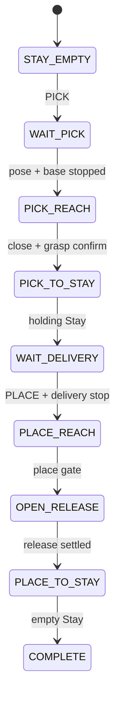

# 배송 정책 v4 실제 로봇 배포

| 항목 | 값 |
|---|---|
| 배포일 | 2026-08-02 |
| 학습 모델 | `arm_delivery_pitch_hold_v4` |
| 실제 패키지 | `omx_rl_control`, `omx_rl_control_cpp`, `turtlebot3_control` |
| 실기기 구동 | 수행하지 않음 |

## 1. 배포 결론

- Python과 C++ 기본 모델을 v4로 전환했다.
- 두 런타임 모두 `PICK → Stay holding → PLACE → Stay empty`를 지원한다.
- 운반 중 베이스 이동은 외부 navigation이 담당하며 팔 PPO action에는
  포함되지 않는다.
- coordinator는 픽업 도착, 파지 완료, 운반 출발, 배송지 재도착,
  Place 완료를 서로 다른 상태로 관리한다.
- 통합 launch의 기존 `move_to_stay_pose:=true`는 변경하지 않았다.

## 2. 배포 artifact

```text
omx_rl_control/models/policies/arm_delivery_pitch_hold_v4/
├── policy.zip
├── policy_metadata.yaml
├── runtime_manifest.yaml
├── training_config.yaml
├── source_model_manifest.yaml
├── SHA256SUMS
└── evaluation/
```

| 계약 | 값 |
|---|---|
| observation / action | 33 / 4 |
| action schema | 3 |
| 지원 명령 | `PICK`, `PLACE` |
| 제어 | reference + PPO residual 10% + joint4 pitch 결합 |
| 제어 주기 | 0.02 s |
| 운반 팔 상태 | `PICK_TO_STAY_HOLDING_OBJECT` |
| policy SHA-256 | `ce5403ddffaf69181801400959824700346d28b64bb559bab93fcdbe16f9aafb` |

manifest v2는 파일 checksum을 별도 `SHA256SUMS`에 둔다. Python 로더는
v2를 검증하면서 기존 v1 artifact도 rollback용으로 계속 읽을 수 있다.

| C++ actor 항목 | 값 |
|---|---|
| 위치 | `omx_rl_control_cpp/models/arm_delivery_pitch_hold_v4/policy_actor.bin` |
| actor SHA-256 | `379a38e4866ba2d6f57942f61998ec74f685c50984fc3a0f6e005764987e70d4` |
| actor 구조 | 33 → 256 Tanh → 256 Tanh → 4 |

## 3. 실제 제어 상태



- `PLACE`는 `grasped=true`이고 `WAIT_DELIVERY`일 때만 수락한다.
- 접근 중 object/delivery pose가 stale하면 HOLD로 전환한다.
- 통합 launch는 `base_arrived` freshness와 odometry 정지를 모두 요구한다.
- `delivery_pose_required=false`이면 학습 기준 fallback
  `[0.27, 0.0, 0.1815] m`를 사용한다.
- 측정한 배치점을 사용할 때는 `delivery_pose_required:=true`와
  `base_link` frame의 `/target/delivery_pose`를 제공한다.

## 4. coordinator와 외부 주행 계약

```text
NAVIGATING_PICK
  -> PICKING
  -> WAIT_TRANSPORT_DEPARTURE
  -> TRANSPORTING
  -> PLACING
  -> DONE
```

외부 navigation은 다음 순서를 지켜야 한다.

1. 픽업 지점에 정지하면 `base_arrived=true`를 주기적으로 발행한다.
2. `grasp complete` 뒤 배송 목표로 출발하면서
   `base_arrived=false`를 주기적으로 발행한다.
3. 배송지에 정지한 뒤 `base_arrived=true`를 다시 발행한다.
4. coordinator가 `/rl_control/command=PLACE`를 전송한다.
5. `pick place complete`에서만 최종 DONE/HOLD가 된다.

`require_transport_departure=true`가 픽업 지점의 과거 true를 배송 도착으로
재사용하지 못하게 한다.

## 5. 빌드와 무동작 확인

```bash
cd /home/ktj/omx_turtle_ws
source /opt/ros/humble/setup.bash
colcon build --symlink-install --packages-select \
  omx_rl_control omx_rl_control_cpp turtlebot3_control
source install/setup.bash
```

```bash
ros2 launch turtlebot3_control omx_turtle.launch.py \
  start_hardware:=false start_eef_vision:=false \
  start_mux:=false start_coordinator:=false \
  control_runtime:=python

ros2 launch turtlebot3_control omx_turtle.launch.py \
  start_hardware:=false start_eef_vision:=false \
  start_mux:=false start_coordinator:=false \
  control_runtime:=cpp
```

하드웨어가 없으면 `/joint_states`와 gripper action server가 없으므로
`NOT_READY`가 정상이다. actor/model 버전과 startup validation 오류가
없는지만 확인한다.

## 6. 실기기 적용 순서

1. E-Stop, 작업 공간, Stay 자세를 확인한다.
2. 물체 없이 상태와 gate만 확인한다.
3. 저속 수동 PICK 한 번과 `WAIT_DELIVERY` 파지 유지를 확인한다.
4. 실제 배송 pose를 측정하고 물체 없이 PLACE 경로를 확인한다.
5. 외부 navigation의 false→true 운반 신호를 연결한다.
6. 물체를 포함한 1회 배송 후 timeout, HOLD, E-Stop을 확인한다.
7. Python 반복 검증 뒤 같은 순서로 C++를 검증한다.

MuJoCo의 100회 성공 수치를 실기기 성공률로 사용하지 않는다. 이 작업에서는
실제 controller를 시작하거나 로봇을 움직이지 않았다.
