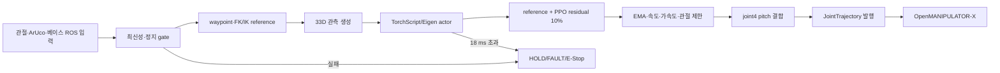

# C++ PPO 로봇 제어 코드가 긴 이유

| 항목 | 기준 |
|---|---|
| 대상 패키지 | `omx_rl_control_cpp` |
| 대상 모델 | `arm_delivery_pitch_hold_v4` |
| 코드 기준일 | 2026-08-02 |
| 핵심 질문 | PPO 모델 하나를 사용하는데 C++ 코드가 왜 긴가? |

## 1. 결론

긴 코드 대부분은 PPO 신경망 계산이 아니다. 실제 PPO actor는 33차원 관측을
받아 4차원 residual action을 만드는 작은 MLP다.

```text
33D observation
  -> Linear(33, 256) -> Tanh
  -> Linear(256, 256) -> Tanh
  -> Linear(256, 4)
  -> clip[-1, 1]
```

하지만 이 프로젝트의 C++ 노드는 단순한 모델 재생기가 아니라 다음 역할을
한 프로세스에서 수행하는 **실제 로봇 매니퓰레이터 제어 런타임**이다.

- ROS 2 토픽과 Action 연결
- 카메라, 관절, 베이스 상태의 최신성 검사
- PICK부터 PLACE까지 17개 상태 관리
- FK, numerical IK와 충돌 회피 waypoint 생성
- reference 제어와 PPO residual 결합
- joint4 pitch 유지, 속도·가속도·관절 한계 적용
- 비동기 그리퍼 명령과 결과 처리
- timeout, HOLD, FAULT, E-Stop 처리
- TorchScript CUDA/CPU와 Eigen CPU fallback
- 추론 deadline 및 상태 로그 발행

따라서 코드 길이는 대체로 `모델 크기`가 아니라 `로봇 동작 계약과 안전
조건의 수`에 의해 결정된다.

## 2. 현재 코드 크기

현재 production C++ 코드와 헤더는 약 2,520줄이다.

| 파일 | 줄 수 | 주 역할 |
|---|---:|---|
| `src/rl_control_cpp_node.cpp` | 1,452 | ROS 연결, 상태 머신, gate, 그리퍼, 오류 복구 |
| `src/runtime_math.cpp` | 514 | FK/IK, 33D 관측, reference, action limiter |
| `src/policy_actor.cpp` | 262 | TorchScript/Eigen 모델 로딩과 actor 추론 |
| `include/runtime_math.hpp` | 175 | 수학·제어 클래스 계약 |
| `include/policy_actor.hpp` | 58 | actor backend 공통 인터페이스 |
| `src/policy_probe.cpp` | 59 | 모델 단독 패리티 검사 |

가장 긴 `rl_control_cpp_node.cpp`가 전체의 약 58%다. 반면 신경망 계산은
`PolicyActor::predict()` 내부의 세 선형층, 두 Tanh와 clamp다. Actor 파일이
262줄인 이유도 신경망 수식이 복잡해서가 아니라 다음 배포 처리가 포함되기
때문이다.

- Eigen 바이너리 magic, 버전, 차원과 유한값 검사
- TorchScript 모델 로딩과 warm-up
- `auto/cpu/cuda` 장치 선택
- CUDA 사용 불가 시 오류 처리
- Tensor 입출력 shape와 NaN/Inf 검사
- Eigen fallback과 출력 clamp

## 3. 학습 코드, 모델, 로봇 런타임은 서로 다르다

| 구분 | 하는 일 | 실제 로봇 C++에 포함 여부 |
|---|---|---|
| PPO 학습 | rollout, reward, advantage, optimizer로 weight 갱신 | 없음 |
| PPO value network | 학습 중 상태 가치 추정 | 없음 |
| deterministic actor | 관측 33개에서 action 4개 계산 | 있음 |
| reference controller | 큰 이동 방향과 waypoint 생성 | 있음 |
| 로봇 상태 머신 | PICK/PLACE/복귀/대기 순서 관리 | 있음 |
| 안전 계층 | timeout, 제한, E-Stop, 명령 중단 | 있음 |
| ROS 어댑터 | 센서 입력과 trajectory/상태 출력 | 있음 |

실제 로봇에서는 PPO 전체를 실행하는 것이 아니다. 학습이 끝난 actor만
가져와 추론하고, value network, reward와 optimizer는 배포하지 않는다.

## 4. 한 번의 50 Hz 제어 주기

현재 핵심 경로는 `handlePolicyMotion()`에 모여 있다.



코드를 단순화한 의사 코드는 다음과 같다.

```cpp
if (!inputs_are_fresh() || !base_is_stopped()) {
  hold_arm();
  return;
}

reference.advance(current_joints);
observation = build_33d_observation();
ppo_residual = actor.predict(observation);
target = limiter.step(ppo_residual, reference.action());
publish_joint_trajectory(target);
```

겉으로는 짧지만 각 함수 안에는 실제 로봇에서 필요한 입력 검증과 실패
처리가 있다. 예를 들어 `actor.predict()`가 성공해도 물체 pose가 오래됐거나
베이스가 움직이면 그 action은 모터로 보내면 안 된다.

## 5. 가장 긴 이유 1: 설정과 계약 검증

`loadConfiguration()`은 약 155줄이며 C++ 노드에서 `parameterOr`를 호출하는
곳은 79개다. 공용 YAML에는 Python/C++ 양쪽에서 사용하는 파라미터까지
약 90개가 있다.

설정에는 단순 gain만 있는 것이 아니다.

- 관절명과 관절별 최소·최대값
- 작업공간과 `base_link`/학습 좌표 offset
- 제어 주기와 trajectory 시간
- reference/residual 비율과 action scale
- Stay 자세와 IK 초기값
- 접근 waypoint와 pregrasp offset
- 카메라·관절·베이스 timeout
- 파지 gate 거리·방위·자세 조건
- 그리퍼 위치, effort와 timeout
- PICK/PLACE 토픽과 호환 토픽
- TorchScript/Eigen backend와 device 선택

이 값들을 검사하지 않으면 잘못된 YAML 하나가 관절 한계를 없애거나 잘못된
좌표계로 팔을 전개할 수 있다. 설정 코드가 긴 것은 값이 많아서이기도 하지만,
실행 전에 잘못된 계약을 거부하기 위해서다.

## 6. 가장 긴 이유 2: ROS 입출력은 모델 입력보다 많다

현재 노드는 11개 subscription, 4개 publisher, 1개 Gripper Action client와
1개 50 Hz timer를 가진다.

| 종류 | 예시 | 필요한 이유 |
|---|---|---|
| 물체 입력 | `/target/object_pose`, `/target/aruco_pose`, `/target/valid` | 물체 위치와 검출 신뢰성 분리 |
| 배송 입력 | `/target/delivery_pose`, base arrival, odometry | PLACE 위치와 베이스 정지 확인 |
| 로봇 입력 | `/joint_states` | 현재 관절과 속도 관측 생성 |
| 안전 입력 | `/safety_stop` | 즉시 E-Stop 전환 |
| 명령 입력 | `/rl_control/command`, `/mp_control/start` | 새 명령과 기존 인터페이스 호환 |
| 팔 출력 | `/arm_controller/joint_trajectory` | 실제 관절 controller 명령 |
| 그리퍼 출력 | GripperCommand Action | 완료·stall·실패를 비동기로 수신 |
| 상태 출력 | `/rl_control/status`, `/mp_control/status` | coordinator와 사람이 상태 확인 |

신경망에는 최종적으로 정리된 33개 숫자만 들어가지만, 그 숫자가 믿을 수
있는지 결정하려면 여러 ROS 입력의 frame, timestamp와 상태를 함께 봐야 한다.

## 7. 가장 긴 이유 3: PICK/PLACE는 한 번의 predict가 아니다

현재 상태 머신에는 17개 상태가 있다.

```text
NOT_READY -> ALIGN_STAY -> STAY_EMPTY -> WAIT_PICK
-> OPEN_GRIPPER -> PICK_REACH -> CLOSE_GRIPPER -> VERIFY_GRASP
-> PICK_TO_STAY -> WAIT_DELIVERY
-> PLACE_REACH -> OPEN_RELEASE -> PLACE_TO_STAY -> COMPLETE

예외 상태: HOLD, FAULT, E_STOP
```

PPO actor가 직접 결정하는 것은 주로 다음 네 phase의 residual action이다.

1. `PICK_REACH`
2. `PICK_TO_STAY`
3. `PLACE_REACH`
4. `PLACE_TO_STAY`

그리퍼 열기·닫기, 접촉 확인, 배송 대기, release settle과 E-Stop은 연속
관절 action이 아니라 사건과 완료 응답을 기다려야 하는 로봇 상태다. 이들을
모델 action 하나로 숨기면 timeout이나 실패 복구 지점을 알 수 없게 된다.

## 8. 가장 긴 이유 4: PPO는 전체 제어가 아니라 residual이다

현재 정책의 최종 명령은 다음 구조다.

```text
final action = reference action + 0.10 * PPO residual
```

Reference controller는 물체 방향으로 `joint1`을 정렬하고, 차체 위 안전점과
전방 안전점을 지나며, numerical IK로 pregrasp 관절을 구한다. PPO는 그 기준
경로를 최대 10% 범위에서 보정한다.

따라서 C++에는 모델 추론 외에도 다음 수학 코드가 필요하다.

- `OpenManipulatorKinematics`: FK, bearing, numerical IK
- `ObservationBuilder`: 학습과 같은 33차원 순서와 정규화
- `ReferenceController`: waypoint, Stay, pregrasp와 phase별 기준 action
- `ActionLimiter`: EMA, 적분, 관절·속도·가속도 제한과 pitch 결합

PPO가 모든 관절 목표를 처음부터 끝까지 직접 출력하도록 다시 학습하면
reference 코드를 일부 줄일 수 있다. 그러나 이는 단순 리팩터링이 아니라
정책 구조, reward, 안전 검증과 Sim2Real 조건을 다시 설계하는 변경이다.

## 9. 가장 긴 이유 5: 실제 로봇은 실패가 정상적으로 발생한다

시뮬레이터에서는 매 step에 관측이 들어오지만 실제 시스템에서는 다음 일이
발생한다.

- 카메라가 ArUco를 잠시 놓친다.
- object pose와 `target_valid`의 갱신 시간이 다르다.
- `/joint_states`가 늦거나 누락된다.
- 베이스가 완전히 멈추기 전에 PICK 명령이 들어온다.
- 그리퍼가 물체에서 stall되거나 Action 응답이 늦는다.
- CUDA 첫 실행이나 시스템 부하로 추론 deadline을 넘을 수 있다.
- E-Stop이 어느 상태에서든 들어올 수 있다.

그래서 각 입력에는 freshness 검사, 각 동작에는 timeout, 각 출력에는 제한이
있다. 실패 시에도 동일하게 멈추지 않는다.

| 상태 | 의미 | 재개 방식 |
|---|---|---|
| `HOLD` | 일시적 조건 상실, 현재 관절 유지 | 원인 확인 후 `RESET` |
| `FAULT` | 명령 또는 장치 실패 | 오류 제거 후 명시적 reset |
| `E_STOP` | 안전 정지 입력 | safety 해제와 명시적 reset |

이 코드를 지우면 줄 수는 줄지만, 센서 한 번의 누락이 오래된 목표를 향한 팔
동작으로 이어질 수 있다.

## 10. GPU를 사용해도 ROS 코드가 짧아지지는 않는다

TorchScript CUDA 전환은 `PolicyActor::predict()`의 연산 backend를 바꾼다.
카메라 메시지, 상태 머신, IK, 그리퍼 Action과 안전 gate는 계속 CPU의 ROS
executor에서 실행된다.

즉 다음 두 문장은 동시에 참이다.

- PPO actor의 행렬 계산은 `cuda:0`에서 수행할 수 있다.
- 전체 `rl_control_cpp_node`는 여전히 긴 ROS/제어 상태 코드를 필요로 한다.

CUDA는 추론 시간을 바꾸는 선택이지 PICK/PLACE 절차를 대신하는 기능이
아니다. 멀티스레드 executor로 바꾸는 것도 줄 수를 줄이지 않으며, 현재 공유
상태에 mutex와 callback group 설계가 추가돼 오히려 복잡해질 수 있다.

## 11. 모델만 단독 사용하는 프로그램과의 차이

모델 파일이 정상인지 확인하는 `policy_probe`는 59줄이다. 이 프로그램은
다음만 수행한다.

1. actor 파일을 연다.
2. 관측 33개를 읽는다.
3. `predict()`를 한 번 호출한다.
4. action 4개를 출력한다.

이 정도가 “모델만 활용하는 C++ 프로그램”의 크기다. 그러나 여기에는 카메라,
관절 controller, 그리퍼, timeout, PICK/PLACE 순서와 E-Stop이 없다. 실제
로봇을 움직이는 프로그램과 모델 단독 probe의 코드 크기를 직접 비교하면
안 되는 이유다.

## 12. 현재 구조에서 실제로 개선할 부분

필요한 안전 기능과 별개로 `rl_control_cpp_node.cpp` 1,452줄이 한 클래스에
모인 것은 유지보수 관점에서 개선할 수 있다. 코드를 삭제하기보다 책임별로
나누는 것이 적절하다.

```text
omx_rl_control_cpp/
├── policy_actor.*          # TorchScript/Eigen 추론
├── runtime_config.*        # 파라미터 로딩과 계약 검사
├── runtime_math.*          # FK/IK, 관측, reference, limiter
├── manipulation_fsm.*      # 17개 상태와 전이 규칙
├── safety_monitor.*        # freshness, base stop, deadline gate
├── gripper_client.*        # 비동기 Action 수명주기
├── ros_io.*                # subscription/publisher 변환
└── rl_control_cpp_node.cpp # 위 모듈 조립과 50 Hz timer
```

권장 리팩터링 순서는 다음과 같다.

1. 동작을 바꾸지 않고 `RuntimeConfig`를 먼저 분리한다.
2. 상태 전이만 입력/출력으로 갖는 `ManipulationStateMachine`을 분리한다.
3. freshness와 base interlock을 `SafetyMonitor`로 옮긴다.
4. Gripper Action callback을 `GripperClient`로 분리한다.
5. 각 모듈에 단위시험을 추가한 뒤 node를 얇은 조립 계층으로 만든다.

이렇게 하면 전체 줄 수가 크게 줄지는 않아도, 특정 오류를 찾기 위해 1,452줄
전체를 읽을 필요는 없어진다. 반대로 안전 gate를 제거해서 파일만 짧게 만드는
것은 적절한 개선이 아니다.

## 13. 모델을 교체할 때 수정되는 범위

| 모델 변경 | C++ 수정 범위 |
|---|---|
| 같은 33D/4D 계약으로 weight만 변경 | `.pt`/`.bin` 재export와 checksum·패리티 검사 |
| hidden layer 크기만 변경 | TorchScript는 그대로 가능, Eigen loader 차원 대응 필요 |
| 관측 순서나 크기 변경 | `ObservationBuilder`, metadata, probe와 golden test 수정 |
| action 의미나 크기 변경 | `ActionLimiter`, 관절 매핑과 안전 시험 수정 |
| phase 추가 | 상태 머신과 phase one-hot 계약 수정, 재학습 필요 |
| residual이 아닌 end-to-end 정책 | reference/IK 구조 재설계와 실기기 안전 검증 필요 |

현재처럼 관측 33개, action 4개와 네 phase가 유지되면 새 checkpoint를 적용할
때 1,452줄 노드를 다시 작성할 필요는 없다. 모델 export와 패리티 검사가 주된
변경이다.

## 14. 코드에서 확인할 위치

| 확인 대상 | 코드 위치 |
|---|---|
| Actor 로딩과 CUDA/Eigen 추론 | [`policy_actor.cpp`](../omx_rl_control_cpp/src/policy_actor.cpp) |
| 50 Hz 상태 분기 | [`rl_control_cpp_node.cpp`](../omx_rl_control_cpp/src/rl_control_cpp_node.cpp) `onControlTimer()` |
| 관측 → PPO → 최종 관절 목표 | 같은 파일의 `handlePolicyMotion()` |
| freshness와 파지 gate | 같은 파일의 `reachGate()` 및 `*Fresh()` |
| HOLD/FAULT/E-Stop | 같은 파일의 `enterHold()`, `enterFault()`, `enterEstop()` |
| FK/IK와 33D 관측 | [`runtime_math.cpp`](../omx_rl_control_cpp/src/runtime_math.cpp) |
| reference + residual 제한 | 같은 파일의 `ReferenceController`, `ActionLimiter` |
| 실제 파라미터 | [`rl_control.yaml`](../omx_rl_control/config/rl_control.yaml) |
| 모델 단독 실행 예 | [`policy_probe.cpp`](../omx_rl_control_cpp/src/policy_probe.cpp) |

## 15. 한 문장 요약

**PPO 모델 코드는 짧지만, 그 action을 실제 로봇에서 올바른 시점에 안전한
관절 명령으로 바꾸고 실패 시 멈추게 만드는 코드가 길다.**
