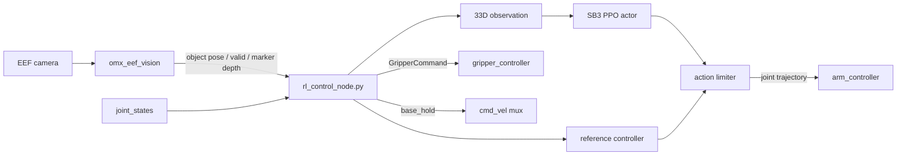
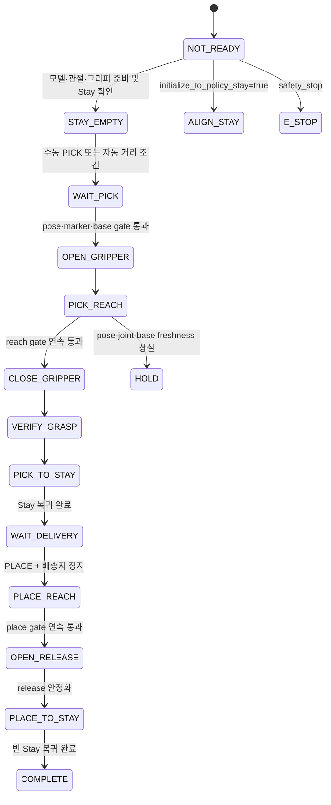

# Python 매니퓰레이터 제어 코드 분석

| 항목 | 기준 |
|---|---|
| 분석일 | 2026-08-02 |
| 소스 저장소 | `/home/ktj/omx_turtle_ws/src` |
| 대상 패키지 | `omx_rl_control` |
| 기본 모델 | `arm_delivery_pitch_hold_v4` |
| 실행 노드 | `omx_rl_control/omx_rl_control/rl_control_node.py` |

## 1. 결론

현재 매니퓰레이터 제어는 PPO가 관절 목표를 단독 생성하는 구조가 아니다.
결정론적 reference controller가 물체 방향으로 `joint1`을 맞추고 두 개의
충돌 회피 waypoint와 pregrasp IK를 생성한다. PPO는 이 기준 행동에 10%
residual을 더하며, 마지막 safety layer가 필터·속도·가속도·관절 한계와
그리퍼 pitch 결합을 적용한다.

최신 `arm_delivery_pitch_hold_v4` 계약은 `PICK`과 `PLACE`를 지원한다.
Python 상태기계는 파지 후 `WAIT_DELIVERY`에서 외부 베이스 운반을 허용하고,
배송지 정지 확인 뒤 접근·release·빈 Stay 복귀까지 수행한다.

## 2. 코드 분할과 책임

| 파일 | 책임 |
|---|---|
| `rl_control_node.py` | ROS 입출력, 정책 로딩, 상태 전이, timeout·E-Stop |
| `model_contract.py` | manifest·metadata·checksum·관측/행동 공간 검증 |
| `observation_builder.py` | 학습과 동일한 33차원 관측 생성 |
| `reference_controller.py` | joint1 방위, waypoint, pregrasp IK, Stay 기준 행동 |
| `kinematics.py` | URDF 치수 기반 FK와 damped numerical IK |
| `action_limiter.py` | residual 합성, EMA, 속도·가속도·관절 제한, pitch 결합 |
| `gripper_manager.py` | 비동기 `GripperCommand` Action과 stall 판정 |
| `state_machine.py` | 런타임 상태와 학습 phase 번호 정의 |

`rl_control_node.py`가 50 Hz 타이머에서 위 모듈을 조합한다. 인식은
`omx_eef_vision`, 실제 trajectory 실행은 `arm_controller`, 그리퍼 구동은
`gripper_controller`가 담당하므로 제어 노드가 하드웨어 드라이버를 직접
호출하지 않는다.

## 3. 데이터 흐름



## 4. 33차원 관측 계약

| 인덱스 | 크기 | 내용 | 정규화 |
|---:|---:|---|---|
| 0–3 | 4 | `joint1`~`joint4` 위치 | joint low/high → `[-1, 1]` |
| 4–7 | 4 | 관절 속도 | `joint_velocity_scale`로 나눔 |
| 8 | 1 | 그리퍼 위치 | open/close 범위 → `[-1, 1]` |
| 9 | 1 | 그리퍼 속도 | `0.25`로 나눔 |
| 10–12 | 3 | EEF 위치 | 학습 workspace 정규화 |
| 13–15 | 3 | 활성 목표 위치 | 학습 workspace 정규화 |
| 16–18 | 3 | 목표−EEF 상대 위치 | workspace span 정규화 |
| 19–20 | 2 | 목표 bearing | `sin`, `cos` |
| 21–22 | 2 | 목표 yaw | `sin`, `cos` |
| 23 | 1 | `joint2+joint3+joint4` pitch 오차 | π로 나눔 |
| 24 | 1 | 파지 여부 | 0 또는 1 |
| 25–28 | 4 | Pick/return/Place/return phase | one-hot |
| 29–32 | 4 | 직전 PPO action | `[-1, 1]` |

Vision은 `base_link` 자세를 발행하고 정책은 `base_footprint` 기준으로 학습됐기
때문에 관측 생성 시 Z축 `+0.016 m` 오프셋을 적용한다. 이 값은 runtime
manifest와 YAML이 다르면 시작 단계에서 오류로 처리한다.

## 5. 행동 합성과 자세 유지

한 제어 주기의 핵심 계산은 다음과 같다.

```text
control = clip(reference_action + 0.10 × ppo_action, -1, 1)
filtered = filtered + 0.18 × (control - filtered)
requested_delta = filtered × 0.014 rad
```

그 뒤 관절별 최대 속도 `0.70 rad/s`, 최대 가속도 `8.0 rad/s²`, 관절
위치 범위를 적용한다. 제어 주기는 `0.02 s`, 실기 trajectory 시간은
`0.08 s`이며 매 4주기마다 trajectory를 발행한다.

최신 모델은 접근 중 다음 결합을 강제한다.

```text
joint4_target = 0.0 - joint2_target - joint3_target
```

따라서 `joint2 + joint3 + joint4 ≈ 0`을 유지해 그리퍼 pitch를 고정한다.
`joint4` 한 주기 최대 보정량은 `0.028 rad`다. `joint1`은 목표 위치와 팔
베이스 `(-0.08, 0)` 사이의 `atan2` bearing으로 waypoint를 회전시키므로,
물체가 좌우로 바뀌면 함께 회전한다.

## 6. 상태기계와 게이트



자동 PICK 시작은 다음을 모두 요구한다.

- 베이스 정지 조건 통과
- `/target/object_pose`와 `/target/valid`가 `0.50 s` 이내
- `/target/aruco_pose` 깊이가 `0.50 s` 이내
- marker Z가 `0.10–0.265 m`

그리퍼 close는 EEF와 pregrasp 목표가 아래 범위에 4회 연속 들어와야 한다.

- 3D 거리 `≤ 0.042 m`
- XY 거리 `≤ 0.035 m`
- Z 오차 `≤ 0.030 m`
- joint1 bearing 오차 `≤ 0.35 rad`
- 그리퍼 pitch 오차 `≤ 0.35 rad`

이 값은 카메라의 유효 검출 범위 `0.04–1.0 m`와 다른 제어 게이트다.

## 7. ROS 인터페이스

| 방향 | 이름 | 타입 | 용도 |
|---|---|---|---|
| 입력 | `/target/object_pose` | `PoseStamped` | `base_link` 기준 파지 목표 |
| 입력 | `/target/aruco_pose` | `PoseStamped` | 카메라 기준 marker Z 시작 게이트 |
| 입력 | `/target/valid` | `Bool` | 비전 자세 유효성 |
| 입력 | `/target/delivery_pose` | `PoseStamped` | 선택적 배송 배치 목표 |
| 입력 | `/turtlebot3_control/base_arrived` | `Bool` | 픽업·배송 도착 gate |
| 입력 | `/odom` | `Odometry` | 베이스 정지 확인 |
| 입력 | `/joint_states` | `JointState` | 관절 위치·속도 |
| 입력 | `/rl_control/command` | `String` | PICK/PLACE/HOLD/RESET/E_STOP |
| 입력 | `/mp_control/start` | `Bool` | 기존 coordinator 호환 PICK |
| 입력 | `/safety_stop` | `Bool` | E-Stop |
| 출력 | `/arm_controller/joint_trajectory` | `JointTrajectory` | 네 관절 목표 |
| Action | `/gripper_controller/gripper_cmd` | `GripperCommand` | 개폐와 접촉 stall 처리 |
| 출력 | `/target/base_hold` | `Bool` | 팔 동작 중 베이스 정지 우선권 |
| 출력 | `/rl_control/status` | `String` | 상세 런타임 상태 |
| 출력 | `/mp_control/status` | `String` | coordinator 호환 상태 |

## 8. 모델 로딩과 실패 처리

기본 artifact는
`models/policies/arm_delivery_pitch_hold_v4`다. 시작할 때 다음을 검사한다.

- manifest v1의 내장 파일 SHA-256 또는 manifest v2의 `SHA256SUMS`
- training config checksum
- 관측 33, 행동 4, joint 이름과 frame offset
- action schema 3과 pitch 결합 파라미터
- SB3 observation/action space
- warm-up 추론 3회

정책 추론이 `0.018 s`를 넘으면 해당 출력을 버리고 연속 3회 초과 시 HOLD로
전환한다. joint/pose timeout, NaN·Inf, IK 실패와 gripper Action 실패도
계속 진행하지 않고 HOLD 또는 FAULT로 전환한다.

## 9. 현재 확인된 한계

- 최신 모델은 627,232 step에서 선택한 PICK/PLACE/배송 정책이다.
- delivery full-tower 100회는 100%·충돌 0%, sim-to-real robust 100회는
  98%·충돌 2%지만 모두 MuJoCo 결과다.
- 외부 navigation 패키지가 배송 목표, `nav_cmd_vel`,
  `base_arrived=false→true` 운반 신호를 제공해야 전체 배송이 이어진다.
- 실제 로봇의 반복 파지 성공률과 카메라 캘리브레이션 오차는 아직 별도다.
- Python 런타임 기본 추론 장치는 CUDA이므로 로봇의 PyTorch/SB3 환경에
  의존한다.
- `object_offset_xyz/rpy`가 아직 0이므로 실제 마커 부착 위치를 보정해야 한다.
- 시작 자세 변경은 이 제어 노드가 자동으로 수행하지 않는다.
  `initialize_to_policy_stay=false`에서는 외부 bringup이 Stay를 만든 뒤
  노드가 허용 오차만 확인한다.
