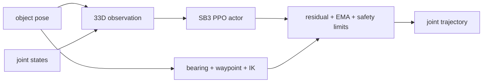

# omx_rl_control

OpenMANIPULATOR-X의 `joint1`~`joint4`를 Stable-Baselines3 PPO actor와
결정론적 reference controller로 제어하는 Python ROS 2 패키지다. 베이스
이동과 그리퍼 개폐는 학습 action이 아니라 상태기계가 담당한다.

## 현재 기본 계약

| 항목 | 값 |
|---|---|
| 모델 | `arm_delivery_pitch_hold_v4` |
| 관측/행동 | 33 / 4 |
| 지원 명령 | `PICK`, `PLACE` |
| 제어 | reference + PPO residual 10% |
| 주기 | 50 Hz |
| 자세 유지 | `joint2 + joint3 + joint4 ≈ 0` |
| joint1 | 물체 위치 bearing으로 접근 waypoint 회전 |
| 모델 검증 | manifest·metadata·SHA-256·공간 계약 |

최신 모델은 PICK, 물체를 든 Stay 복귀, 외부 베이스 운반 구간, PLACE와
빈 그리퍼 Stay 복귀를 학습했다. MuJoCo delivery full-tower 평가는
100회 성공·충돌 0회, sim-to-real robust 평가는 98회 성공·충돌 2회다.
이는 실제 로봇 반복 성공률과는 구분한다.

## 제어 흐름



행동 합성은 `reference + 0.10 × PPO`이며 EMA `0.18`, action scale
`0.014 rad`, 최대 속도 `0.70 rad/s`, 최대 가속도 `8.0 rad/s²`를 적용한다.
접근 중 joint4는 joint2·joint3과 결합해 그리퍼 pitch를 유지한다.

## 주요 인터페이스

| 방향 | 이름 | 타입 |
|---|---|---|
| 입력 | `/target/object_pose` | `geometry_msgs/msg/PoseStamped` |
| 입력 | `/target/aruco_pose` | `geometry_msgs/msg/PoseStamped` |
| 입력 | `/target/valid` | `std_msgs/msg/Bool` |
| 입력 | `/target/delivery_pose` | `geometry_msgs/msg/PoseStamped` |
| 입력 | `/turtlebot3_control/base_arrived` | `std_msgs/msg/Bool` |
| 입력 | `/odom` | `nav_msgs/msg/Odometry` |
| 입력 | `/joint_states` | `sensor_msgs/msg/JointState` |
| 입력 | `/rl_control/command` | `std_msgs/msg/String` |
| 입력 | `/safety_stop` | `std_msgs/msg/Bool` |
| 출력 | `/arm_controller/joint_trajectory` | `trajectory_msgs/msg/JointTrajectory` |
| Action | `/gripper_controller/gripper_cmd` | `control_msgs/action/GripperCommand` |
| 출력 | `/target/base_hold` | `std_msgs/msg/Bool` |
| 출력 | `/rl_control/status` | `std_msgs/msg/String` |
| 호환 | `/mp_control/start`, `/mp_control/status` | `Bool`, `String` |

## 빌드와 실행

```bash
cd /home/ktj/omx_turtle_ws
source /opt/ros/humble/setup.bash
colcon build --symlink-install --packages-select omx_rl_control
source install/setup.bash

ros2 launch omx_rl_control rl_control.launch.py
```

기본 설정은 `policy_device: cuda`다. 로봇의 ROS Python에서 PyTorch와
Stable-Baselines3를 import할 수 있어야 한다. CPU로 확인할 때는 별도 설정
파일에서 `policy_device: cpu`를 명시한다.

통합 실행은 다음을 사용한다.

```bash
ros2 launch turtlebot3_control omx_turtle.launch.py \
  control_runtime:=python
```

C++ 구현은 [`omx_rl_control_cpp`](../omx_rl_control_cpp/)에 있으며 같은 토픽
계약으로 선택 실행할 수 있다.

`PLACE`는 파지 확인 후 `WAIT_DELIVERY`에 도달한 경우에만 수락한다.
통합 launch는 fresh base-arrival와 정지 odometry를 요구한다. 배송 pose를
별도로 발행하지 않으면 학습 기준 고정 pose
`[0.27, 0.0, 0.1815]`를 사용한다.

## 안전 게이트

- 관절 상태, object pose, ArUco depth와 필요 시 base/odom freshness 확인
- marker Z `0.10–0.265 m`에서만 자동 PICK 시작
- EEF/pregrasp 거리·XY·Z·bearing·pitch를 4회 연속 확인한 뒤 close
- 추론 deadline `0.018 s` 연속 3회 초과 시 HOLD
- NaN·Inf, IK 실패, gripper Action 실패 시 FAULT/HOLD
- E-Stop에서 gripper goal 취소와 현재 관절 hold

시작 자세는 `initialize_to_policy_stay=false`일 때 이 노드가 변경하지 않고
외부 bringup이 Stay를 만든 상태인지 확인만 한다.

상세 분석은
[`docs/7. Python 매니퓰레이터 제어 코드 분석.md`](<../docs/7. Python 매니퓰레이터 제어 코드 분석.md>)를
참조한다.
